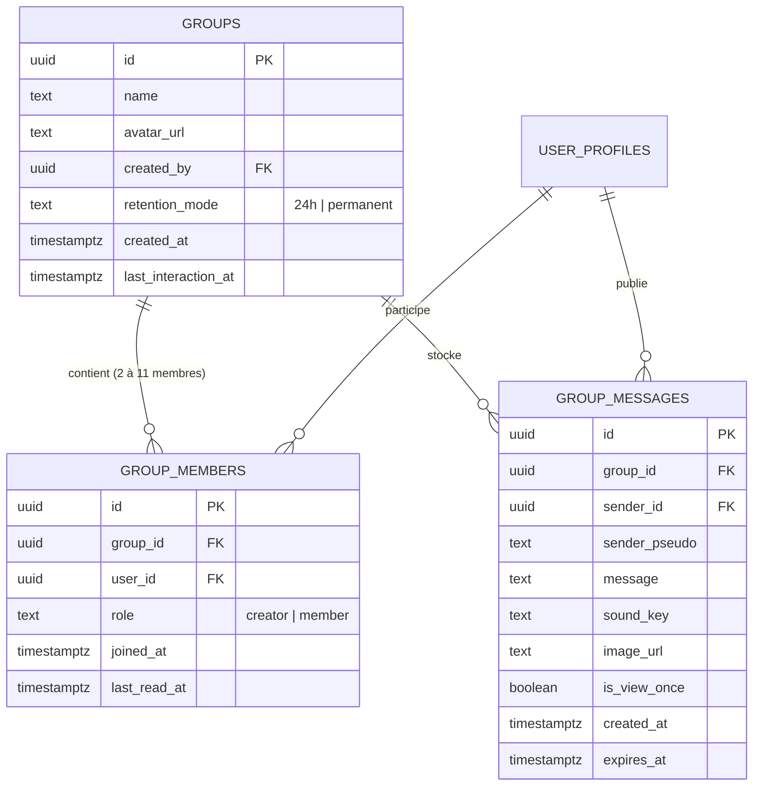

# 📑 Spécification Technique & Plan d'Implémentation — "GroopProot"

**Date de rédaction :** 13 Octobre 2026  
**Statut :** Validé — À implémenter ultérieurement  

---

## 1. 🎯 Résumé & Spécifications Validées

Le module **GroopProot** introduit la notion de groupes d'amis au sein de l'application Proot ! Il combine deux fonctionnalités phares :
1. **Le Prout de Groupe (Action Swipe) :** Envoyer simultanément un prout à l'ensemble des membres du groupe d'un seul geste.
2. **Le Chat de Groupe (Action Clic) :** Échanger dans une conversation collective avec affichage du pseudo au-dessus des bulles reçues (style WhatsApp), avec gestion de la rétention (24h ou permanent).

### Règles Métier Définies :
- **Accès & Entrée UI :** Une icône double bonhomme (`people-outline` de Ionicons) intégrée dans la barre supérieure ([`AppHeader.tsx`](../components/AppHeader.tsx)), positionnée à droite du bouton d'ajout d'ami (`person-add-outline`).
- **Capacité :** De **2 à 10 amis maximum** par groupe (+ le créateur).
- **Règle de Rétention (définie par le créateur) :**
  - **Mode 24 Heures :** Tous les messages et photos s'effacent automatiquement au bout de 24h.
  - **Mode 0h / Permanent :** L'historique des messages et médias est conservé.
  - *Note :* La « Vue Unique (①) » reste disponible individuellement pour les photos éphémères immédiates.
- **Scores de Complicité :** Les points de complicité (flammes, badges sniper/nuit) restent réservés aux échanges 1-à-1 pour ne pas fausser les métriques individuelles.
- **Cycle de Vie du Groupe :**
  - N'importe quel membre peut quitter le groupe à tout moment.
  - Seul le créateur a le droit de dissoudre/supprimer le groupe.

---

## 2. 🗄️ Architecture Base de Données (Supabase)



### Migration SQL Cible (`supabase/migrations/supabase_groopproot.sql`) :

```sql
-- 1. Table des groupes
CREATE TABLE IF NOT EXISTS public.groups (
    id UUID PRIMARY KEY DEFAULT gen_random_uuid(),
    name TEXT NOT NULL CHECK (char_length(name) >= 2 AND char_length(name) <= 50),
    avatar_url TEXT,
    created_by UUID NOT NULL REFERENCES auth.users(id) ON DELETE CASCADE,
    retention_mode TEXT NOT NULL DEFAULT '24h' CHECK (retention_mode IN ('24h', 'permanent')),
    created_at TIMESTAMPTZ NOT NULL DEFAULT now(),
    last_interaction_at TIMESTAMPTZ NOT NULL DEFAULT now()
);

-- 2. Table des membres du groupe (limite 10 amis max)
CREATE TABLE IF NOT EXISTS public.group_members (
    id UUID PRIMARY KEY DEFAULT gen_random_uuid(),
    group_id UUID NOT NULL REFERENCES public.groups(id) ON DELETE CASCADE,
    user_id UUID NOT NULL REFERENCES auth.users(id) ON DELETE CASCADE,
    role TEXT NOT NULL DEFAULT 'member' CHECK (role IN ('creator', 'member')),
    joined_at TIMESTAMPTZ NOT NULL DEFAULT now(),
    last_read_at TIMESTAMPTZ DEFAULT now(),
    CONSTRAINT unique_group_user UNIQUE(group_id, user_id)
);

-- 3. Table des messages de groupe
CREATE TABLE IF NOT EXISTS public.group_messages (
    id UUID PRIMARY KEY DEFAULT gen_random_uuid(),
    group_id UUID NOT NULL REFERENCES public.groups(id) ON DELETE CASCADE,
    sender_id UUID NOT NULL REFERENCES auth.users(id) ON DELETE CASCADE,
    sender_pseudo TEXT NOT NULL,
    message TEXT,
    sound_key TEXT,
    image_url TEXT,
    is_view_once BOOLEAN NOT NULL DEFAULT false,
    created_at TIMESTAMPTZ NOT NULL DEFAULT now(),
    expires_at TIMESTAMPTZ -- Calculé si retention_mode = '24h' (created_at + 24 hours)
);

-- Index d'optimisation
CREATE INDEX IF NOT EXISTS idx_group_members_user ON public.group_members(user_id);
CREATE INDEX IF NOT EXISTS idx_group_members_group ON public.group_members(group_id);
CREATE INDEX IF NOT EXISTS idx_group_messages_group ON public.group_messages(group_id, created_at DESC);
CREATE INDEX IF NOT EXISTS idx_group_messages_expires ON public.group_messages(expires_at) WHERE expires_at IS NOT NULL;

-- Activation RLS
ALTER TABLE public.groups ENABLE ROW LEVEL SECURITY;
ALTER TABLE public.group_members ENABLE ROW LEVEL SECURITY;
ALTER TABLE public.group_messages ENABLE ROW LEVEL SECURITY;

-- Politiques RLS (lecture et écriture strictement limitées aux membres)
CREATE POLICY "Members can view their groups"
ON public.groups FOR SELECT
USING (
    EXISTS (SELECT 1 FROM public.group_members WHERE group_members.group_id = groups.id AND group_members.user_id = auth.uid())
);

CREATE POLICY "Members can view messages"
ON public.group_messages FOR SELECT
USING (
    EXISTS (SELECT 1 FROM public.group_members WHERE group_members.group_id = group_messages.group_id AND group_members.user_id = auth.uid())
);

CREATE POLICY "Members can insert messages"
ON public.group_messages FOR INSERT
WITH CHECK (
    auth.uid() = sender_id AND
    EXISTS (SELECT 1 FROM public.group_members WHERE group_members.group_id = group_messages.group_id AND group_members.user_id = auth.uid())
);

CREATE POLICY "Creators can update or delete their groups"
ON public.groups FOR ALL
USING (auth.uid() = created_by);
```

---

## 3. 📱 Architecture Frontend & Expérience Utilisateur

### A. Bouton Header ([`components/AppHeader.tsx`](../components/AppHeader.tsx))
- Ajout de la prop `onGroopProotPress?: () => void`.
- Intégration dans `leftIconsContainer` :
  ```tsx
  {!(isProfileMenuOpen || isProfileOpen) && onGroopProotPress && (
    <TouchableOpacity
      onPress={onGroopProotPress}
      style={[styles.iconButton, { justifyContent: 'center', alignItems: 'center', minHeight: 28 }]}
      accessibilityLabel="Créer un GroopProot"
    >
      <Ionicons name="people-outline" size={24} color="#ffffff" />
    </TouchableOpacity>
  )}
  ```

### B. Modale de Création (`GroopProotModal.tsx`)
- Composant dédié placé dans `components/FriendsListComponents/Modals/`.
- **Formulaire interactif :**
  1. Champ texte pour le nom du groupe.
  2. Sélecteur à deux boutons pour la rétention :
     - ⏳ **24 Heures** (par défaut)
     - ♾️ **Permanent (0h)**
  3. Liste des amis avec cases à cocher.
  4. Compteur : `Amis sélectionnés : X / 10`. Si 10 amis sont sélectionnés, les cases restantes sont grisées.
  5. Bouton de création actif si 2 à 10 amis sont cochés et le nom renseigné.

### C. Liste d'Amis & Ligne de Groupe ([`SwipeableFriendRow.tsx`](../components/FriendsListComponents/SwipeableFriendRow.tsx))
- Dans `useFriends.ts` : fusion des amis acceptés et des groupes dont l'utilisateur est membre dans un tableau unifié.
- Sur la ligne de la FlashList :
  - Avatar avec icône de groupe 👥.
  - Nom du groupe affiché en titre principal.
  - Badges d'état : `👥 {nbMembres}` et `⏳ 24h` ou `♾️`.
  - **Swipe Prout :**
    - Récupération des tokens des membres du groupe (hors expéditeur).
    - Respect des modes Zen de chaque destinataire.
    - Appel optimisé en une seule requête vers l'Edge Function pour la diffusion push simultanée.
  - **Clic / Tap :**
    - Navigation vers `/chat?groupId={id}&groupName={encodeURIComponent(name)}&retention={mode}`.

---

## 4. 💬 Chat de Groupe Style WhatsApp ([`app/chat.tsx`](../app/chat.tsx))

### A. Identification Visuelle des Membres ([`ReceivedBubble.tsx`](../components/chat/ReceivedBubble.tsx))
Pour chaque bulle reçue dans un groupe :
- Affichage du pseudo en gras au-dessus du texte :
  ```tsx
  {isGroup && !isSenderMe && (
    <Text style={[styles.senderPseudoHeader, { color: getConsistentColorForPseudo(message.sender_pseudo) }]}>
      {message.sender_pseudo}
    </Text>
  )}
  ```
- **Palette de couleurs harmonieuse :** Fonction de hachage déterministe attribuant une couleur stable par pseudo parmi une palette inspirée de WhatsApp (Bleu ciel, Émeraude, Corail, Violet pastel, Ambre, Rose framboise).

### B. Prise en charge Multimédia & Purge
- Envoi de sons associés au message texte.
- Photos éphémères :
  - Supprimées après 24 heures si le groupe est en mode 24h.
  - Conservées si le groupe est en mode permanent.
  - Mode Vue Unique (①) disponible pour destruction immédiate à la fermeture.

---

## 5. 📅 Jalons d'Implémentation (Roadmap)

| Phase | Intitulé | Tâches & Livrables |
| :---: | :--- | :--- |
| **1** | **Base de données Supabase** | Migration SQL des tables `groups`, `group_members`, `group_messages`, indexes et politiques RLS. |
| **2** | **Bouton & Modale de Création** | Icône `people-outline` dans `AppHeader` + création du composant `GroopProotModal.tsx` avec limite de 10 amis et choix 24h/0h. |
| **3** | **FriendsList & Swipe Multi-Prout** | Adaptation de `useFriends.ts` (requête combinée) et `SwipeableFriendRow.tsx` pour déclencher le prout groupé. |
| **4** | **Chat de Groupe WhatsApp** | Adaptation de `app/chat.tsx` pour `groupId`, canal Realtime Supabase, et en-tête de pseudo dans `ReceivedBubble.tsx`. |
| **5** | **Nettoyage 24h & Gestion du Groupe** | Cron/trigger de purge des messages 24h, options "Quitter le groupe" et "Supprimer le groupe". |
