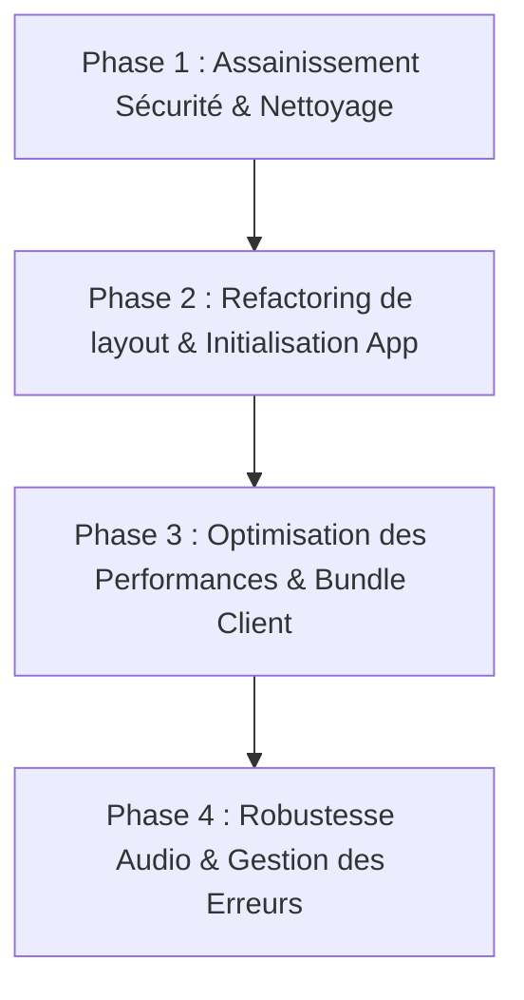

# 📋 Audit complet de l'application Proot (ProutApp)
**Date** : 8 août 2026  
**Domaines analysés** : Sécurité, Stabilité, Performance & Architecture

---

## 📌 1. Synthèse Globale

```
┌────────────────────────────────────────────────────────────────────────┐
│                        RÉSUMÉ DU BILAN TECHNIQUE                      │
├───────────────────┬────────────────────────────────────────────────────┤
│ 🛡️ Sécurité       │ ⚠️ CRITIQUE : Clés de service exposées, JWT en     │
│                   │ AsyncStorage non chiffré, endpoints sans proxy.    │
├───────────────────┬────────────────────────────────────────────────────┤
│ ⚡ Stabilité      │ 🟧 MAJEUR : Init bloquante sans fallback, boucle  │
│                   │ active sur Zustand, fuites potentielles expo-av.   │
├───────────────────┬────────────────────────────────────────────────────┤
│ 🚀 Performance    │ 🟧 MAJEUR : Dépendances backend dans le bundle     │
│                   │ client, composant FriendsList de 184 KB, I/O      │
│                   │ AsyncStorage répétés sur le thread principal.      │
└───────────────────┴────────────────────────────────────────────────────┘
```

---

## 🛡️ 2. Audit de Sécurité & Confidentialité

### 2.1 Exposition de Clés Privées et Fichiers de Configuration Sensibles
* **Localisation** : [`.env`](file:///Users/fuzz/Proutapp/.env#L10)
* **Constat** : Le fichier `.env` du projet contient la clé administrative Supabase `SUPABASE_SERVICE_ROLE_KEY` qui possède un droit d'accès total à la base de données sans appliquer les règles RLS (Row Level Security), ainsi que le token `SENTRY_AUTH_TOKEN`.
* **Fichiers de credentials Firebase / Google** : Presence de [`firebase-service-account.json`](file:///Users/fuzz/Proutapp/firebase-service-account.json), [`credentials.json`](file:///Users/fuzz/Proutapp/credentials.json), [`GoogleService-Info.plist`](file:///Users/fuzz/Proutapp/GoogleService-Info.plist) et [`google-services.json`](file:///Users/fuzz/Proutapp/google-services.json) dans l'arborescence du projet mobile.

### 2.2 Contournement des Edge Functions et Authentification Bypassed
* **Localisation** : [`lib/matchContactsBackend.ts:L3-L16`](file:///Users/fuzz/Proutapp/lib/matchContactsBackend.ts#L3-L16)
* **Constat** : La fonction `matchContactsViaBackend` effectue un appel HTTP direct vers le backend NestJS (`https://prout-backend.onrender.com/friends/match-contacts`) en injectant une clé API statique codée en dur (`82d6d94d97ad501a596bf866c2831623`).
* **Risque** : Cela contourne totalement la Edge Function Supabase [`prout-proxy`](file:///Users/fuzz/Proutapp/supabase/functions/prout-proxy/index.ts#L35) qui sert normalement de passe-plat sécurisé pour vérifier les jetons JWT des utilisateurs et certifier leur `userId`. N'importe quel client externe peut décompiler l'application et moissonner la liste des contacts enregistrés.
* **Localisation** : [`lib/sendProut.ts:L3-L29`](file:///Users/fuzz/Proutapp/lib/sendProut.ts#L3-L29)
* **Constat** : Envoi direct de push notifications via l'API Expo Push depuis le client sans validation par le serveur.

### 2.3 Stockage Non-Chiffré du Jeton de Session (JWT Auth Storage)
* **Localisation** : [`lib/supabase.ts:L16-L22`](file:///Users/fuzz/Proutapp/lib/supabase.ts#L16-L22)
* **Constat** : Supabase Auth est configuré pour persister le token d'authentification utilisateur dans `@react-native-async-storage/async-storage`. Sur Android et iOS, `AsyncStorage` conserve les données en texte clair dans une base de données SQLite/XML locale non chiffrée.

### 2.4 Confidentialité du Carnet d'Adresses (PII Privacy)
* **Localisation** : [`lib/matchContactsBackend.ts:L13-L15`](file:///Users/fuzz/Proutapp/lib/matchContactsBackend.ts#L13-L15)
* **Constat** : Les numéros de téléphone sont transmis bruts au serveur lors du matching sans hachage préalable côté client (ex: SHA-256 avec sel).

---

## ⚡ 3. Audit de Stabilité & Résilience aux Erreurs

### 3.1 Blocage de l'Initialisation au Démarrage (Init Freeze)
* **Localisation** : [`app/_layout.tsx:L144-L181`](file:///Users/fuzz/Proutapp/app/_layout.tsx#L144-L181) & [`lib/services/AppInitializer.ts:L33-L40`](file:///Users/fuzz/Proutapp/lib/services/AppInitializer.ts#L33-L40)
* **Constat** : Au démarrage, la fonction `initializeApp()` s'exécute dans un `Promise.all` bloquant pour attendre la réponse de `supabase.auth.getSession()`. En cas de panne de réseau, d'erreur de résolution DNS ou d'indisponibilité temporaire de Supabase, l'application reste figée indéfiniment sur l'écran d'attente (Splash Screen) sans fallback ni timeout.

### 3.2 Boucle d'Attente Active (Busy-Wait Loop) dans NotificationService
* **Localisation** : [`lib/services/NotificationService.ts:L43-L47`](file:///Users/fuzz/Proutapp/lib/services/NotificationService.ts#L43-L47)
* **Constat** : Lors de la réception d'un message par notification push (particulièrement au Cold Start), `injectMessageFromNotification` tente d'attendre l'hydratation du store Zustand avec une boucle `while (!useChatStore.getState().hasHydrated && retry < 30) await setTimeout(100)`. Si l'hydratation tarde, le message injecté peut être rejeté ou perdu.

### 3.3 Libération des Ressources Audio (`expo-av`)
* **Localisation** : [`lib/audioService.ts:L16-L39`](file:///Users/fuzz/Proutapp/lib/audioService.ts#L16-L39)
* **Constat** : Les objets `Audio.Sound` ne sont pas garantis d'être déchargés (`unloadAsync()`) lors de démontages prématurés de composants ou de déclenchements de sons simultanés. Cela entraîne une saturation progressive de la mémoire audio native sur iOS/Android.

### 3.4 Incohérence d'État Offline / Session Null
* **Localisation** : [`lib/services/AppInitializer.ts:L48-L51`](file:///Users/fuzz/Proutapp/lib/services/AppInitializer.ts#L48-L51)
* **Constat** : En cas de déconnexion réseau au boot, `offlineAccess` bascule à `true` sur la base de la clé `supabase_was_logged_in`, mais la variable `session` reste à `null`. Les vues qui tentent d'accéder à `session.user.id` lèvent des exceptions non gérées (`TypeError: Cannot read property 'id' of null`).

---

## 🚀 4. Audit de Performance, Bundle & État

### 4.1 Infiltration de Paquets Serveur/Backend dans le Client React Native
* **Localisation** : [`package.json:L59-L60`](file:///Users/fuzz/Proutapp/package.json#L59-L60)
* **Constat** : Le `package.json` inclut `firebase-admin` (`^13.8.0`) et `expo-server-sdk` (`^4.0.0`) dans les `dependencies`. Ces bibliothèques sont destinées à des environnements Node.js backend. Elles alourdissent le bundle JavaScript et peuvent bloquer le bundler Metro.

### 4.2 Composants Monolithiques & Hotspots de Re-render
* **Localisation** :
  * [`components/FriendsList.tsx`](file:///Users/fuzz/Proutapp/components/FriendsList.tsx) (**184 KB**)
  * [`app/chat.tsx`](file:///Users/fuzz/Proutapp/app/chat.tsx) (**72 KB**)
* **Constat** : La centralisation de la logique métier, des animations reanimated, des écouteurs temps réel et du rendu UI dans des fichiers géants provoque des re-rendus complets de la liste à la moindre mise à jour d'état d'un ami ou d'une réaction.

### 4.3 I/O Disque Synchrone sur Événements Fréquents
* **Localisation** : [`lib/services/NotificationService.ts:L122`](file:///Users/fuzz/Proutapp/lib/services/NotificationService.ts#L122)
* **Constat** : À chaque notification push interceptée, l'application exécute un appel `AsyncStorage.getItem('haptic_feedback_enabled')`. La lecture répétée du disque sur l'évent loop dégrade la fluidité de l'UI.

### 4.4 Risque de Saturation du Storage par React Query Persister
* **Localisation** : [`app/_layout.tsx:L40-L61`](file:///Users/fuzz/Proutapp/app/_layout.tsx#L40-L61)
* **Constat** : La persistance du cache React Query est paramétrée sur une durée de rétention de 30 jours (`gcTime: 30 jours`) dans `AsyncStorage`. La quantité de données accumulées risque de dépasser les plafonds recommandés du stockage local mobile.

### 4.5 Artefacts et Fichiers Volumineux Inutilisés
* **Fichiers binaires à la racine** : [`build-1785830201095.aab`](file:///Users/fuzz/Proutapp/build-1785830201095.aab) (127 MB), [`build-1785829848301.ipa`](file:///Users/fuzz/Proutapp/build-1785829848301.ipa) (62 MB).
* **Fichiers résiduels** : [`components/FriendsList.backup.tsx`](file:///Users/fuzz/Proutapp/components/FriendsList.backup.tsx) (97 KB), [`components/FriendsList_baaack.tsx`](file:///Users/fuzz/Proutapp/components/FriendsList_baaack.tsx) (97 KB).

---

## 🗺️ 5. Plan d'Action Recommandé



### Phase 1 : Sécurité, Nettoyage des Secrets & Fichiers
1. **Nettoyage des dépendances serveur** : Supprimer `firebase-admin` et `expo-server-sdk` du `package.json`.
2. **Securing Storage Auth** : Implémenter un adaptateur `expo-secure-store` pour `supabase.auth` à la place d'`AsyncStorage`.
3. **Sécurisation des Endpoints Backend** : Faire passer `matchContactsViaBackend` par la Edge Function `prout-proxy` (avec vérification du JWT utilisateur), éliminer l'API Key statique codée en dur.
4. **Hachage des Numéros de Téléphone** : Hacher les numéros en SHA-256 avec un sel avant l'envoi au serveur pour le matching.
5. **Nettoyage des fichiers build et doublons** : Ajouter les gros `.aab`/`.ipa` au `.gitignore` et supprimer les fichiers de backup mort dans `components/`.

### Phase 2 : Refactoring Architectural de `app/_layout.tsx`
1. **Extraction de `AppInitializer`** : Intégrer un timeout de secours (3 secondes max) sur `supabase.auth.getSession()` pour éviter le freeze au démarrage.
2. **Extraction des services** : Séparer `NotificationService` et `AuthService/SessionProvider` du composant de layout principal.
3. **Passage des Préférences Haptiques dans Zustand** : Éliminer la lecture `AsyncStorage.getItem('haptic_feedback_enabled')` à chaque notification au profit du store Zustand.

### Phase 3 : Découpage & Performance UI
1. **Découpage de `FriendsList.tsx` (184 KB)** : Modulariser `FriendsList` en sous-composants mémoïsés (`React.memo`) avec sélecteurs Zustand ciblés.
2. **Ajustement de la rétention React Query** : Réduire le `gcTime` d'AsyncStorage de 30 jours à 7 jours ou filtrer les requêtes volumineuses hors du persister.

### Phase 4 : Stabilité Audio & Error Boundaries
1. **Gestionnaire de cycle de vie `Audio.Sound`** : Sécuriser la libération automatique (`sound.unloadAsync()`) lors de l'arrêt/changement de son dans `audioService.ts`.
2. **Error Boundaries ciblés** : Placer des `AppErrorBoundary` spécifiques autour des onglets et du Chat pour éviter qu'un crash local ne plante toute l'application.
